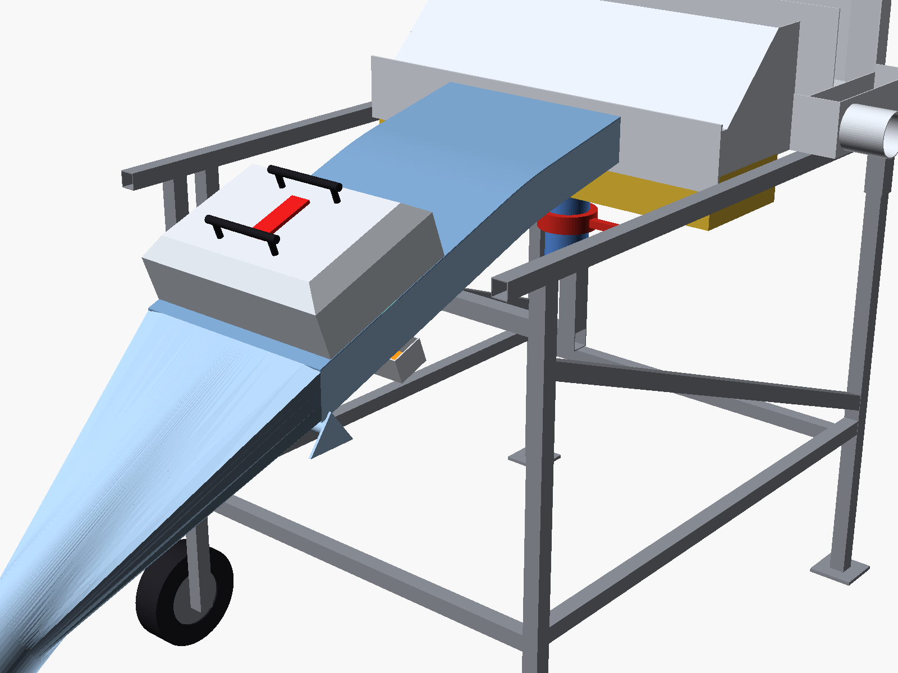
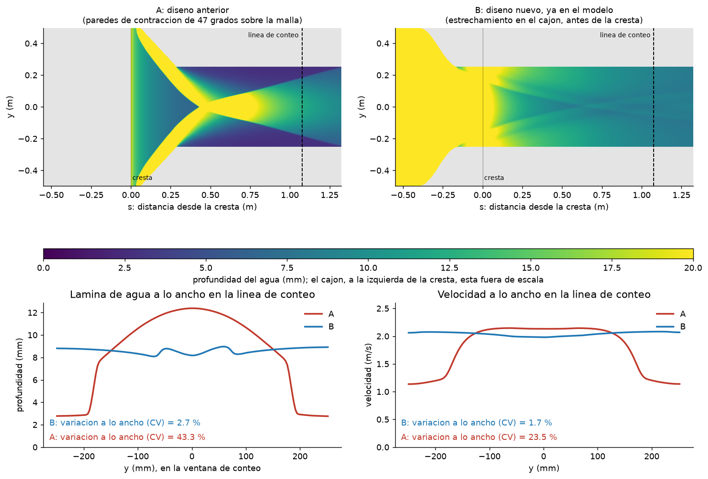
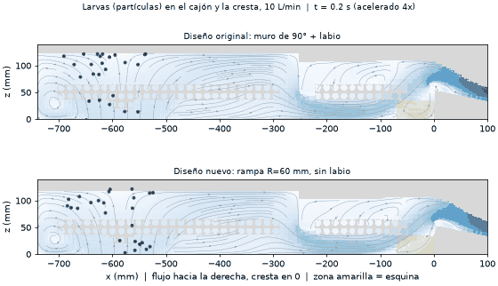

# Optical counter for shrimp post-larvae

Design study for a machine that counts shrimp post-larvae automatically while they are pumped from one tank to another. The larvae travel in a thin, fast sheet of water over a backlit window, and a camera counts their silhouettes.

The repository holds the whole engineering trail: the parametric 3D model, the hydraulic simulations that shaped the channel, the leak and collision checks, the optics and electronics specifications, and the build package for a first physical test rig.

**Live demos:** [interactive flow diagram](https://andre17-hsx.github.io/shrimp-larvae-optical-counter/diagrama_flujo/diagrama_flujo.html) (3D model, flow animation and camera view) · [3D CFD viewer](https://andre17-hsx.github.io/shrimp-larvae-optical-counter/cfd_3d/informe_preliminar/index.html)

> **Status:** design and simulation. Nothing here has been validated against a physical prototype yet. The detailed documents are written in Spanish.



## The problem

Hatcheries sell post-larvae by the million and count them by hand from small samples, which is slow and gives errors of 10 % or more. A camera can count every animal, but only if the water presents them well:

- one layer of larvae, so they do not hide each other;
- the same speed across the whole channel width, so no larva is counted twice or missed;
- a smooth surface with no foam or waves, so the silhouettes stay sharp.

Most of the work in this repository went into getting that sheet of water right.

## What was done

| Area | Folder | Summary |
|---|---|---|
| Parametric 3D model | [`Fusion360_VAKI_Macro/`](Fusion360_VAKI_Macro/) | One Fusion 360 Python script builds the full machine (about 90 bodies) from named dimensions: inlet box, baffle, contraction, weir crest, drainage mesh, chute, counting window, outlet funnel and frame. |
| 1D and 2D hydraulics | [`simulacion_flujo/`](simulacion_flujo/) | A standard-step water profile and a custom shallow-water (Saint-Venant) finite-volume solver, verified against Manning flow and oblique-shock theory. Report: [`INFORME_FLUJO.md`](simulacion_flujo/INFORME_FLUJO.md). |
| 3D CFD | [`cfd_3d/`](cfd_3d/) | OpenFOAM `interFoam` with k-omega SST, up to 1.57 million cells, with case generators, a live monitor and automated analysis against acceptance criteria. Results: [`RESULTADOS_P2.md`](cfd_3d/RESULTADOS_P2.md). |
| Leak and collision checks | [`verificacion_estanqueidad/`](verificacion_estanqueidad/) | Runs the Fusion script outside Fusion (a stand-in `adsk` module on CadQuery), voxelises the parts and searches for paths where water could escape. |
| Test rig build package | [`prototipo_fase1/`](prototipo_fase1/) | Specifications, DXF profiles and coordinate tables for a first water test of the inlet box, crest and chute. |
| Interactive flow diagram | [`diagrama_flujo/`](diagrama_flujo/) | A single HTML page with a 3D viewer of the real model, a particle animation of the flow and a simulation of what the camera sees. Open [`diagrama_flujo.html`](diagrama_flujo/diagrama_flujo.html) in a browser. |
| Optics, lighting and electronics | root `*.md` files | Camera and lens selection, infrared strobe bench, camera-to-LED synchronisation, bill of materials, and a comparison of two architectures (global shutter with strobe, and line scan). |

A full-scale reconstruction of a commercial reference counter (VAKI Macro, one channel) was modelled first to understand the proportions of a proven machine: `modelo_vaki_macro_escala_real.py` and `vaki_macro_escala_real.step`. The manufacturer's drawing it was measured from is not included.

## Main results

**1. Narrowing the channel on the chute does not work.** The original layout narrowed the flow from 994 mm to 504 mm on the drainage mesh, where the water is already fast (Froude number about 7). The 2D solver showed two standing oblique waves crossing at the centre line. At the counting line the depth ran from 2.8 mm at the edges to 12.4 mm in the centre (coefficient of variation 43 %). Seven other contraction shapes on the mesh gave no useful improvement.

**2. Narrowing before the crest does.** Moving the whole contraction into the inlet box, where the water is slow, gives a sheet of 8.0 to 8.9 mm at the counting line (variation 2.7 %) with speed between 1.98 and 2.08 m/s (variation 1.7 %). It stays below 5 % from 4 to 15 L/s. This change was applied to the 3D model.



**3. The 3D CFD supports the simple model.** At 10 L/s the 3D depth and speed along the sheet agree with the 1D model within about 5 to 7 %. The sheet speed is very even across the width (variation 1.2 to 2.2 %), and no air is entrained.

| Distance from crest | CFD depth | CFD speed | 1D depth | 1D speed |
|---|---|---|---|---|
| 0.10 m | 19.3 mm | 0.99 m/s | 19.8 mm | 1.00 m/s |
| 0.30 m | 14.1 mm | 1.37 m/s | 14.8 mm | 1.34 m/s |
| 0.50 m | 11.9 mm | 1.63 m/s | 12.9 mm | 1.54 m/s |

**4. The CFD also found things the simple model could not.**

- Depth across the width varies by 6.6 % at 0.5 m from the crest, above the 5 % target, because of small standing waves of about ±1.3 mm.
- The baffle in the inlet box raises the water level behind it by about 14 mm.
- A separation bubble of 2 to 4 mm forms at the crest lip, which led to testing lip-free and parabolic crest ramps.



**5. Pump pulsation is not fixed by channel shape.** Flow pulsation between 1 and 10 Hz shows up in the sheet, amplified two to three times. It has to be handled at the pump or with a constant-level overflow.

**6. The camera placement in the model needs rework.** Building the camera view on the real geometry showed that the lens sits about 106 mm above the bed, too close to cover the 504 mm channel width with a normal lens. The lit window is also only about 50 mm long in the flow direction, so at 2.2 m/s and 60 frames per second each larva appears in about 1.4 frames, below the 3 frames wanted for tracking.

## Limits and open work

- No physical test has been run. The first test rig is specified but not built.
- The 3D run reached a quasi-steady state, not strict convergence: the box level sloshes by ±0.4 % with a period of about 1 s.
- The 3D cases model the drainage mesh as a solid wall, and the counting window further down the chute has not been simulated in 3D.
- The parabolic crest ramp case is still running, so the choice of final crest shape is open.
- Camera height, lens and window length need to be redesigned (result 6).

## Reproducing

Raw OpenFOAM output (about 4 GB) is not in the repository; the cases, geometry and scripts that produce it are.

```bash
# 1D and 2D hydraulics: Python 3.11 with numpy, scipy and matplotlib
python simulacion_flujo/ejecutar_todo.py
```

```bash
# Leak check: also needs cadquery
python verificacion_estanqueidad/analisis_modelo.py
```

```bash
# Interactive diagram: Node 20 or later
node diagrama_flujo/build.mjs
```

The 3D cases need OpenFOAM on Linux or WSL; see [`cfd_3d/LEEME.md`](cfd_3d/LEEME.md). To build the 3D model, run `Fusion360_VAKI_Macro/Fusion360_VAKI_Macro.py` from Fusion 360 (Utilities, Add-Ins, Scripts).

## Tools

Python (NumPy, SciPy, Matplotlib, CadQuery), Autodesk Fusion 360 API, OpenFOAM, ParaView, OpenSCAD, JavaScript with three.js, MicroPython on a Raspberry Pi Pico.

## Third-party code

- `diagrama_flujo/vendor/three.min.js`: three.js r128, MIT licence.
- `diagrama_flujo/kit/` and `diagrama_flujo/scripts/`: isometric drawing kit, MIT licence (see `diagrama_flujo/kit/LICENSE`).

## Rights

© 2026 andre17-hsx. All rights reserved. The repository is published as a portfolio piece; please ask before reusing the design or the code. VAKI is a trademark of its owner and is mentioned only as a reference; this project is not affiliated with it.
