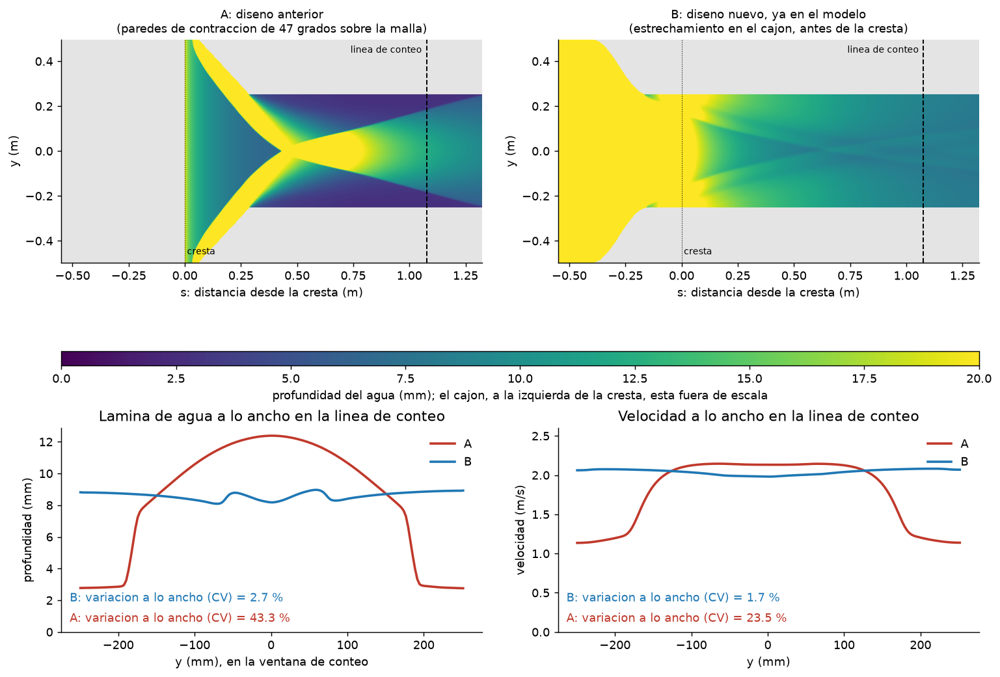

# Informe: simulación del flujo en el canal de conteo

Caudal de diseño 10 L/s, canal de 504 mm, tobogán a 20°, malla de drenaje a 12°. El diseño analizado como **A** es el modelo
de Fusion 360 (`Fusion360_VAKI_Macro.py`) antes de este cambio; **B, la solución propuesta aquí, ya está aplicada al modelo**
(sección 8).

## Respuesta corta

1. **Laminar no se puede: el flujo es turbulento**, Re ≈ 19 000 en la línea de conteo. Lo que sí se puede conseguir, y
   lo que le sirve a la cámara, es una **lámina supercrítica estable, lisa y uniforme a lo ancho**.
2. **El diseño anterior (A) no la conseguía.** Es estable en el tiempo, pero las paredes de contracción de 47° sobre la
   malla generan dos ondas oblicuas que se cruzan en el eje. En la línea de conteo la lámina va de 2,8 mm en los bordes
   a 12,4 mm en el centro (variación CV = 43 %) y la velocidad de 1,1 a 2,1 m/s (CV = 23 %).
3. **Ninguna contracción sobre la malla lo arregla**: probé 7 formas y longitudes (sección 4). En flujo supercrítico
   (Fr ≈ 7) las ondas viajan casi en la dirección del flujo (unos 8° de desvío) y no se disipan en el largo del canal.
4. **La solución es hacer todo el estrechamiento antes de la cresta, en el cajón, donde el flujo es lento** (propuesta B:
   994 → 504 mm en 250 mm con forma de coseno y 150 mm rectos antes de la cresta). Es el principio de un canal Venturi.
   Con B la lámina en la línea de conteo es de 8,0 a 8,9 mm (CV = 2,7 %) y la velocidad de 1,98 a 2,08 m/s (CV = 1,7 %).
5. B mantiene CV < 5 % de 4 a 15 L/s, aguanta una entrada desigual al cajón y sigue uniforme con la malla drenando
   de 0 a 30 % del caudal. Lo que ningún diseño del canal corrige es la pulsación del caudal de la bomba entre 1 y 10 Hz
   (sección 6): se ve en la lámina, hasta unas 2–3 veces más grande que la pulsación original.

Los cambios aplicados al modelo 3D y su verificación (sin fugas ni choques) están en la sección 8.

## 1. Qué se calculó y cuánto confiar

| Etapa | Método |
|---|---|
| 1D | perfil del agua por el método del paso estándar: energía + Manning (n = 0,010) + presión corregida por la curvatura del arco |
| 2D | aguas someras (Saint-Venant) promediadas en profundidad, volúmenes finitos, flujo HLL, reconstrucción MUSCL, Runge-Kutta 2; paredes de contracción como celdas sólidas |
| Larvas | trazadores pasivos sobre el campo 2D, con dispersión turbulenta, y estadística de solapamiento en la imagen |

Verificación del resolvedor (`verificar_swe.py`):

- flujo uniforme sobre plano inclinado: la profundidad coincide con Manning al 0,00 %, empezando en la profundidad
  normal o 40 % más profundo;
- onda oblicua (resalto) en una desviación de pared, contra la teoría (Fr 2, 3 y 4): con dx ≤ 4 mm el ángulo de la
  onda queda dentro de 2,5° y el salto de profundidad dentro de 5 %;
- convergencia de malla del caso A, sin drenaje (dx = 6, 4, 3, 2 mm): profundidad en el eje 13,0 / 13,1 / 13,1 / 13,2 mm y
  CV 33–35 %; del caso B (dx = 4 y 3 mm): CV 2,7 % en ambas;
- el resultado de A no depende del estado inicial (canal lleno de agua lenta o perfil 1D); B tarda unos 7 s simulados en
  estabilizarse del todo, por eso se promedia de 7,5 a 9 s.

Lo que **no** tiene: validación contra un ensayo del propio canal. Ver sección 9.

## 2. Régimen del flujo (1D, diseño anterior A, 10 L/s, sin drenaje)

| Sitio | h (mm) | V (m/s) | Fr |
|---|---|---|---|
| cresta | 21,9 | 0,46 | 1,0 (crítico) |
| fin de la malla | 17,3 | 1,15 | 2,8 |
| inicio del arco | 13,2 | 1,50 | 4,2 |
| **línea de conteo** | **9,7** | **2,04** | **6,8** |
| final del tobogán | 9,2 | 2,17 | 7,5 |

- Re = V·h/ν = 18 900: turbulento. Weber ≈ 560: la tensión superficial no domina.
- La capa límite turbulenta del fondo llega a la superficie libre hacia s = 0,52 m, es decir, ya antes de la línea de
  conteo el flujo es turbulento en toda la profundidad.
- No hay resalto hidráulico ni bloqueo por falta de energía en ningún punto del recorrido.
- Rugosidad (canal angosto, línea de conteo): n = 0,008 → 9,0 mm y 2,21 m/s; n = 0,010 → 9,6 mm y 2,07 m/s;
  n = 0,012 → 10,2 mm y 1,94 m/s; n = 0,016 → 11,6 mm y 1,71 m/s. Una superficie rayada o con biofilm engrosa la lámina.

## 3. Diseño anterior (A)

Estable en el tiempo (oscilación rms < 0,1 mm), pero muy poco uniforme a lo ancho:

| | lámina (mm) | velocidad (m/s) |
|---|---|---|
| bordes (junto a la pared) | 2,8 | 1,1 |
| centro | 12,4 | 2,1 |
| variación a lo ancho (CV) | **43 %** | **23 %** |

- Cada pared de 47° genera una onda oblicua; se cruzan en el eje hacia s = 0,43 m con un pico local de ~50 mm.
  Aguas abajo el agua se acumula en el centro y deja láminas de 3 mm junto a las paredes.
- Junto a las paredes de la contracción el agua casi se detiene (u ≈ 0,02 m/s con 43 mm de profundidad a s = 0,15 m).
  En la simulación de larvas, **el 9 % de las que entran a menos de 10 cm de una pared no llega a la línea de conteo en
  4 s** (1,8 % del total). Con B llegan el 100 %.
- Las larvas se reparten según el caudal local: en A se concentran en el centro (desviación estándar de y 105 mm frente
  a 148 mm si fuera uniforme), donde además la lámina es más gruesa. La imagen de la cámara tendrá más larvas encima
  unas de otras en el centro y láminas de 3 mm en los bordes, donde la larva roza el fondo.
- Con una cámara lineal a frecuencia fija, la velocidad va de 1,1 a 2,1 m/s a lo ancho: el píxel se estira casi el doble
  en los bordes respecto al centro.

## 4. Qué probé sobre la malla (sin efecto útil)

Q = 10 L/s, sin drenaje, dx = 6 mm; CV de la profundidad en la ventana de conteo:

| Contracción | Ángulo máx. de pared | CV |
|---|---|---|
| lineal 0,061–0,288 m (anterior, A) | 47° | 33 % |
| coseno 0,061–0,288 m | 60° | 28 % |
| lineal desde la cresta, 0–0,288 m | 40° | 40 % |
| coseno 0–0,55 m | 35° | 80 % |
| coseno 0–0,75 m | 27° | 71 % |
| coseno 0–0,90 m | 23° | 42 % |
| lineal 0–0,90 m | 15° | 47 % |
| **estrecho desde la cresta (entrada perfectamente uniforme, solo referencia)** | 0° | 0 % |

Alargar o suavizar la contracción no sirve, incluso a 15° la lámina queda mal. La única fila que da lámina uniforme es
la que **no tiene contracción sobre la malla**, y eso obliga a que el agua ya llegue a la cresta con el ancho final.

## 5. Diseño B: estrechar antes de la cresta

Con flujo lento (Fr < 0,4 en el cajón) el estrechamiento no genera ondas de choque: el agua se redistribuye sola. Pero al
llegar a la cresta el flujo pasa a supercrítico y **ya no puede corregir nada aguas arriba**, así que cualquier
velocidad transversal que traiga se congela y se convierte en ondas cruzadas. Por eso hace falta un tramo recto antes de
la cresta para que esa velocidad transversal se apague:

CV de la profundidad en la ventana de conteo (%) según el estrechamiento en el cajón y el caudal (dx = 4 mm, drenaje 15 %):

| Estrechamiento (largo + recto antes de la cresta) | 4 L/s | 8 L/s | 10 L/s | 12 L/s | 15 L/s |
|---|---|---|---|---|---|
| 250 mm lineal + 0 mm | 12,9 | 2,0 | 6,6 | 11,5 | 17,6 |
| 400 mm lineal + 0 mm | 10,5 | 1,5 | 4,9 | 8,6 | 13,3 |
| 250 mm lineal + 100 mm | 5,2 | 9,3 | 10,1 | 10,2 | 9,5 |
| 250 mm lineal + 200 mm | 3,0 | 3,2 | 2,1 | 1,3 | 3,0 |
| **250 mm coseno + 150 mm (diseño B, corrida final)** | **4,3** | **3,6** | **2,7** | **2,2** | **3,7** |
| 300 mm coseno + 200 mm | 2,1 | 3,2 | 2,7 | 2,0 | 1,3 |

(Las demás filas son de la exploración: promedian menos tiempo y usan el nivel de entrada sin calibrar; B se repitió
con la calibración final. Las diferencias entre filas de 1–2 puntos no son significativas.) El punto sensible es el tramo recto: con 100 mm queda peor que sin él,
porque la onda cruzada llega a la línea de conteo en mal momento; con 150–200 mm es bueno en todo el rango de caudal.

Corrida final de B a 10 L/s (dx = 3 mm):

| | A | B |
|---|---|---|
| lámina (mm): media (mín–máx) | 8,4 (2,8–12,4) | 8,6 (8,1–9,0) |
| variación de lámina (CV) | 43 % | 2,7 % |
| velocidad (m/s) | 1,14–2,15 | 1,98–2,08 |
| variación de velocidad (CV) | 23 % | 1,7 % |
| caudal en la línea de conteo (L/s) | 8,3 | 8,9 |

## 6. Robustez de B

**Caudal** (`resultados/fig2_barrido_caudal.png`):

| Q (L/s) | 4 | 6 | 8 | 10 | 12 | 15 |
|---|---|---|---|---|---|---|
| lámina B media (mm) | 4,3 | 5,8 | 7,2 | 8,6 | 10,0 | 12,0 |
| CV B (%) | 4,3 | 4,4 | 3,6 | 2,7 | 2,2 | 3,7 |
| CV A (%) | 64 | 58 | 51 | 43 | 35 | 24 |

**Drenaje de la malla.** El coeficiente de paso de la malla no está medido; lo tomé como parámetro (`kd`), calibrado
para que en A drene 0, 15 o 30 % del caudal. Con más drenaje la lámina es más fina, pero B sigue uniforme:

| Drena en A | A: lámina (mm), CV | B: lámina (mm), CV |
|---|---|---|
| 0 % | 9,8 (3,3–13,1), 34 % | 9,4 (9,0–9,8), 2,1 % |
| 15 % | 8,4 (2,8–12,3), 43 % | 8,6 (8,0–8,9), 2,7 % |
| 30 % | 7,1 (2,4–11,4), 51 % | 7,7 (7,0–8,1), 3,8 % |

B es más angosta en la cresta, así que con la misma malla drena menos (23 % frente a 33 % con el ajuste de 30 %).

**¿Alcanza la malla de B (0,145 m²) sin alargarla?** Velocidad de paso por las aberturas necesaria para cada caudal
drenado, con 25 % de área abierta (`kd` es el parámetro de la simulación, secc. 1):

| Drena en B (L/s de 10) | 1,2 | 2,3 | 3,2 | 4,3 | 5,5 |
|---|---|---|---|---|---|
| fracción del caudal | 12 % | 23 % | 32 % | 43 % | 55 % |
| velocidad de paso por las aberturas | 0,033 m/s | 0,064 m/s | 0,089 m/s | 0,117 m/s | 0,151 m/s |
| lámina en la línea de conteo (mm) | 8,6 | 7,7 | 7,0 | 6,2 | 5,3 |
| velocidad de la lámina (m/s) | 2,03 | 1,96 | 1,89 | 1,80 | 1,67 |

El criterio con que se dimensionó la malla (paso ≤ 0,1 m/s para que no succione la larva contra el tejido) da un máximo de
unos **3,6 L/s (36 %)** con esta malla, frente a unos 7 L/s con la de A. Alcanza para los ~3 L/s que se pensaban drenar, con
poco margen (0,089 de 0,1 m/s). Lo que no se sabe es cuánto drena de verdad una malla de 30 mesh bajo esta lámina: hay que
medirlo en una malla real antes de decidir si alargarla.

**Entrada desigual al cajón** (velocidad de entrada no uniforme, nivel plano; `entrada_desigual.py`):

| Entrada | CV de la lámina en B |
|---|---|
| uniforme | 2,7 % |
| inclinada ±25 % (más caudal a un lado) | 4,7 % |
| inclinada ±50 % | 7,0 % |
| chorro central +100 % | 2,7 % |
| chorro pegado a un lado +100 % | 5,0 % |
| ondulada, 2 crestas ±50 % | 3,1 % |

**Pulsaciones del caudal** (bomba, variador): una pulsación de ±5 % en el caudal produciría ±3,3 % en la lámina si el
agua la siguiera sin amplificar (`resultados/fig3_pulsaciones.png`).

| Frecuencia (Hz) | 0,5 | 1 | 2 | 5 | 10 | 20 |
|---|---|---|---|---|---|---|
| solo el canal, en la línea de conteo | 3,8 % | 3,5 % | 3,9 % | 5,4 % | 6,2 % | 4,0 % |
| con el cajón modelado, en la línea de conteo | 3,8 % | 9,9 % | 5,9 % | 6,4 % | 7,7 % | 1,1 % |

- El canal solo amplifica poco (hasta 1,9 veces, a 10 Hz) y no genera ondas de rodillo por sí mismo en su largo.
- Con el cajón modelado aparece una resonancia hacia 1 Hz (3 veces). **Esta parte depende de cómo modelé el cajón** (0,55 m,
  fondo a la altura de la cresta, entrada fijada), así que no es una predicción: indica que el cajón real podría
  tener modos de oleaje propios y conviene que la bomba no pulse a 1–2 Hz. Una rampa suave en el variador y algo de
  volumen en la impulsión (por ejemplo una pequeña cámara de aire) ayudan a evitarlo.
- A 20 Hz llega solo 1,1 % con el cajón (4,0 % en el canal solo, sin ningún amortiguamiento). Las pulsaciones de los
  álabes de la bomba (cientos de Hz) no se simularon.

## 6b. Volumen del cajón (cálculo directo con la geometría del modelo, no CFD)

Cajón desde la cresta hasta el frente, nivel de trabajo de 112,5 mm sobre su fondo a 10 L/s:

| | |
|---|---|
| superficie del agua en planta | 0,55 m² |
| agua sobre la cresta (52,5 mm) | 29 L |
| agua bajo la cresta (60 mm): **piscina permanente** | 33 L |
| total en el cajón / cono difusor debajo | 62 L / 15 L |
| renovación del cajón a 6 / 10 / 15 L/s | 10 s / 6 s / 4 s |
| velocidad media del agua (10 L/s) | 0,09 m/s en la parte ancha, 0,16–0,18 m/s en el estrechamiento |

- **Filtro de pulsaciones.** Como depósito con la cresta como salida, el cajón tiene una constante de tiempo de unos 2 s
  (`A · dH/dQ` = 0,55 m² × 3,5 mm por L/s), es decir, una frecuencia de corte de ~0,08 Hz. Una pulsación de ±5 % del caudal a
  1 Hz llegaría a la cresta atenuada a ~0,4 %, y a 0,2 Hz a ~2 %. Es una estimación de primer orden (sin oleaje interno del
  cajón); **corrige a la baja la resonancia de 1 Hz de la sección 6**, que salía de forzar el nivel en el borde del modelo 2D.
  Un cajón más chico filtraría menos.
- **Piscina permanente.** Los 33 L bajo la cresta no salen por la cresta y las larvas que caigan ahí se quedan hasta que se
  vacíe con el agua de arrastre de la manguera. Con ~10 larvas por litro son ~330 larvas. Hace falta un enjuague con agua limpia
  entre lotes (unos 3 cambios de volumen = ~10 s a 10 L/s).
- **El límite para un traspaso no es el cajón sino el ritmo de conteo** (sección 7): con ≈ 100–150 larvas/s la pérdida por
  solapamiento sin corregir es < 1 %; con corrección estadística se puede subir a unos 300–500/s.

## 7. Larvas y solapamiento (`resultados/fig4_larvas.png`)

Trazadores pasivos con velocidad 75–100 % de la del agua (van cerca del fondo), dispersión lateral D = 0,15·h·u*, huella
de 10 × 1,5 mm. Tiempo de la cresta a la línea de conteo: 0,85 ± 0,07 s en B (1,13 ± 0,22 s en A). Velocidad de la
larva al cruzar: 1,79 ± 0,15 m/s en B.

El solapamiento en la imagen depende de las larvas por segundo y de cuánta superficie de canal pasa por segundo
(ancho × velocidad ≈ 0,9 m²/s). Conteo perdido por larvas que se tapan entre sí, sin corrección estadística:

| Larvas/s en el canal | 100 | 200 | 300 | 500 | 1000 | 2000 |
|---|---|---|---|---|---|---|
| B, larvas alineadas con el flujo | 0,4 % | 1,1 % | 1,5 % | 2,5 % | 5,0 % | 9,7 % |
| B, orientación aleatoria (peor caso) | 0,8 % | 1,4 % | 1,9 % | 3,3 % | 6,5 % | 12,5 % |
| A, larvas alineadas | 0,7 % | 1,3 % | 1,9 % | 3,3 % | 6,3 % | 12,7 % |

Con 500 larvas/s en 8,9 L/s serían unas 56 larvas por litro. Para menos de 1 % de pérdida sin corregir hay que quedarse
en unas 100–150 larvas/s. El solapamiento es predecible (es casi proporcional a la tasa) y se puede corregir; el
software de conteo también puede separar larvas que se tocan por su área.

## 8. Cambios aplicados al modelo 3D (de A a B)

Hechos en `Fusion360_VAKI_Macro.py`:

1. **Cresta, malla y labio del vertedero con el ancho del canal (504 mm)**, y el **sumidero** con el ancho exterior del canal
   (510 mm, era 1 000: 19,7 L en vez de 38,8 L).
2. **El contorno del cuerpo sigue el estrechamiento.** `pared_estrechamiento_izq/der` son ahora las paredes exteriores del
   cuerpo: continúan las paredes del tobogán (rectas a ±252 mm hasta 150 mm antes de la cresta, X = 2 240) y luego abren en
   coseno durante 250 mm hasta X = 2 490, donde empiezan las paredes laterales rectas. **`pared_lateral_izq/der` se acortaron:
   ahora van solo de X = 2 490 a 2 601.** Ya no hay zonas muertas a los lados del agua: el fondo del cajón, la cubierta
   (510 mm de ancho), la brida (±275 mm), el vertedero, la malla y el sumidero se recortaron a ese mismo contorno, y
   desaparecen las placas ciegas y los bolsillos. Con el ancho de la malla, los soportes de abajo pasan de 9 a 5.
   La constante `X_CONTRACCION` desaparece; entran `L_ESTRECH`, `L_ESTRECH_RECTO` y `N_ESTRECH` (tramos de la polilínea).
3. **El deflector** va ahora de pared a pared del estrechamiento (sus lados siguen la cara interior de las paredes; en
   X = 2 340 mide ±337 mm) y conserva el hueco inferior de 50 mm.
4. **La regla de nivel** pasa a la cara interior de la pared del estrechamiento, en su tramo recto.
5. **Hidráulica del script**: la carga sobre la cresta se calcula con el ancho del canal y Q = 1,705·b·H^1,5 con el factor de
   calibración 1,022 (`COEF_VERTEDERO`, `FACTOR_NIVEL`). **El nivel en el cajón sube de 91 a 112,5 mm** a 10 L/s y el borde
   libre hasta el canto del cajón baja a 188 mm.

6. **Entrada por el fondo sin plato difusor.** Se quitó el plato Ø300 y sus 3 patas: el agua chocaba contra una pared. En su lugar
   hay un **cono difusor** (`difusor_entrada_D260`, del fondo del cajón hacia abajo) de la manguera Ø110 a Ø260 en 560 mm (7,6° de
   semiángulo). La velocidad baja de 1,18 m/s en la manguera a **0,20 m/s en la boca** (carga cinética de 2 mm: el chorro ya no
   rompe la superficie), y el agua sube sin tocar nada. La boca se movió de X = 2 632 a 2 672 para librar la riostra trasera del
   bastidor. En la instalación desaparece la reducción corta Ø110 → Ø160 (17° de semiángulo), la válvula de corte pasa al tramo
   horizontal de la manguera y ese tramo baja solo si hace falta con las patas al mínimo (subida de al menos 140 mm hasta el
   difusor). La simulación de flujo nunca incluyó el plato ni el deflector, así que sus resultados no cambian.

Verificación con las herramientas de `../verificacion_estanqueidad/` sobre el modelo nuevo:

- 91 cuerpos (eran 101 con el modelo original), todos válidos y **0 choques** en las 5 configuraciones de patas y altura de salida;
- **0 fugas** en las cuatro zonas (cajón + malla + sumidero, difusor de entrada, tobogán + carcasa del backlight, embudo + tubo
  + acople). Se añadió la zona del difusor; pruebas provocadas (quitar una pared del estrechamiento o el difusor) las detectan;
- la lista de cuerpos separados por menos de 3 mm es más corta que antes (13 pares, ninguno nuevo salvo un par malla ↔ brida a 2 mm: la malla ahora
  cabe dentro de la ventana de la brida y el fondo del tobogán cierra ese paso).

A tener en cuenta:

- **Menos superficie de malla**: 0,145 m² en vez de 0,286 m². Con la misma malla drena menos (secc. 6); si hace falta más
  drenaje, alargarla (más largo, misma pendiente).
- **El cuadro final del script ya usa la simulación.** Antes calculaba la lámina con la profundidad normal de Manning
  (8,3 mm a 2,39 m/s), pero el tobogán es corto y el agua no llega a esa profundidad. Ahora el script incluye
  `perfil_conteo()`, el mismo perfil 1D de `flujo_1d.py` (coincide con él al milésimo), y muestra a 10 L/s: **9,6 mm a
  2,07 m/s, Froude 7,0, y una frecuencia de línea de 8,4 kHz** (píxel de 0,25 mm; antes 9,7 kHz). Es el valor **sin
  drenaje de la malla**: con la malla drenando 15 % la lámina es de 8,6 mm y la velocidad casi no cambia (2,03 m/s, 8,3 kHz);
  con 30 %, 7,7 mm y 1,96 m/s (8,0 kHz). Cambia solo si cambias `CAUDAL_DISENO`, `MANNING_N` o la geometría del tobogán.
- El modelo **no se ha abierto en Fusion 360**: se verificó con el simulador de `adsk` y CadQuery. Al ejecutar el script en
  Fusion conviene revisar el cuadro final y mirar el cajón desde arriba (`../Fusion360_VAKI_Macro/vista_previa_estrechamiento.png`
  muestra cómo debe verse).

## 9. Límites del modelo y qué falta

- **Modelo promediado en profundidad.** No ve la entrada de aire, la turbulencia de superficie, las ondas capilares de
  2–3 mm ni los flujos secundarios en el cajón y en el pie de la cresta. Con la capa límite ya en la superficie y
  V ≈ 2 m/s, es probable que la superficie se vea rugosa y con algo de espuma; eso afecta la luz del backlight y no está
  en estos números.
- **El cajón se modela con el fondo a la altura de la cresta** (hipótesis desfavorable: velocidad de aproximación 3
  veces mayor que la real). La cresta real tiene un escalón de 60 mm que este modelo no representa.
- **Caudal drenado por la malla**: no está medido, es un parámetro (secc. 6). Conviene medirlo en una malla real.
- **Larvas pasivas**: sin nado, sin adherencia, sin choques contra la pared ni entre ellas; la fracción de velocidad
  (0,75–1,0) es una suposición.
- **Validación**: las pruebas cubren el resolvedor, no el canal. Antes de fabricar, la forma más barata es una maqueta
  transparente del tramo cajón + cresta + primeros 0,6 m con una cámara de teléfono; la segunda es una simulación 3D con
  superficie libre (OpenFOAM, interFoam) solo de esa zona.

## 10. Reproducir

Ver [`LEEME.md`](LEEME.md). Todo sale de `python ejecutar_todo.py` (12 min) y `python sensibilidad.py`; las figuras se
rehacen con `python regenerar_figuras.py`. Los resultados numéricos quedan en `resultados/*.json`.
